# FlyDash

**FlyDash is the successor to [Nexus Dashboard](https://github.com/brainchillz/NexusDashboard-Modular)**:
the same modular Flask backend, API contract, modules, plugins and themes,
presented as a browser desktop — wallpaper, app launcher, taskbar and floating
app windows (Storage, Sharing, SAN, Virtualization, Containers, AI Tools,
Settings …) instead of a sidebar of pages.

Nexus Dashboard is no longer maintained; all development continues here.
FlyDash began as a fork of Nexus Dashboard 3.12.0 and deliberately keeps its
on-disk names (`/opt/nexus-dashboard`, the `nexus-dashboard` service and
helpers), so an existing Nexus Dashboard node upgrades to FlyDash in place —
see [Install](#install). Everything below about Nexus Dashboard still applies
to the backend.

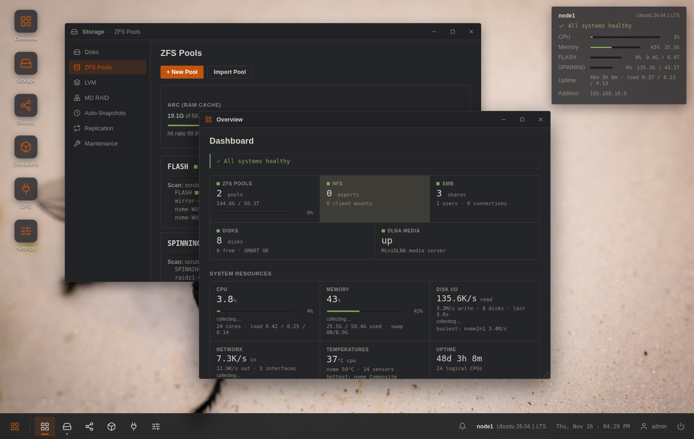

*The desktop (4.1.2): app icons, the node status widget, the taskbar, and two
app windows — Storage and Overview — open over the shipped wallpaper.*

## Screenshots

| | |
|---|---|
| 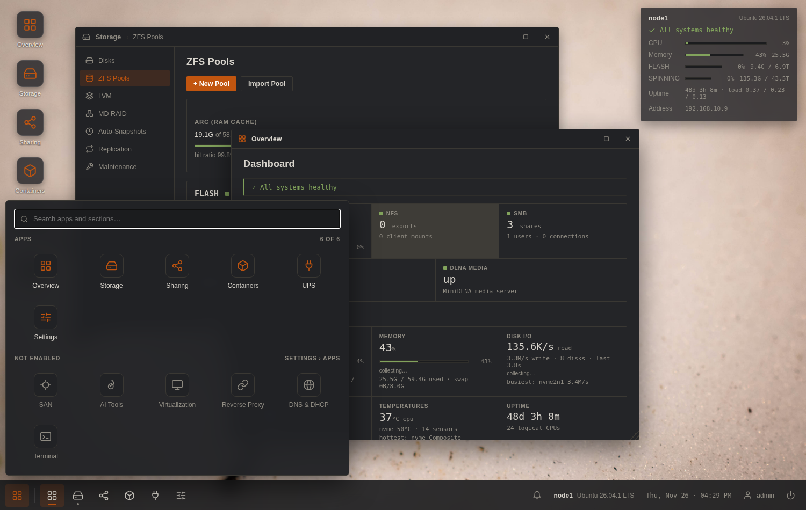<br>**App launcher** — search apps and sections; apps a node does not use are listed as not enabled. | 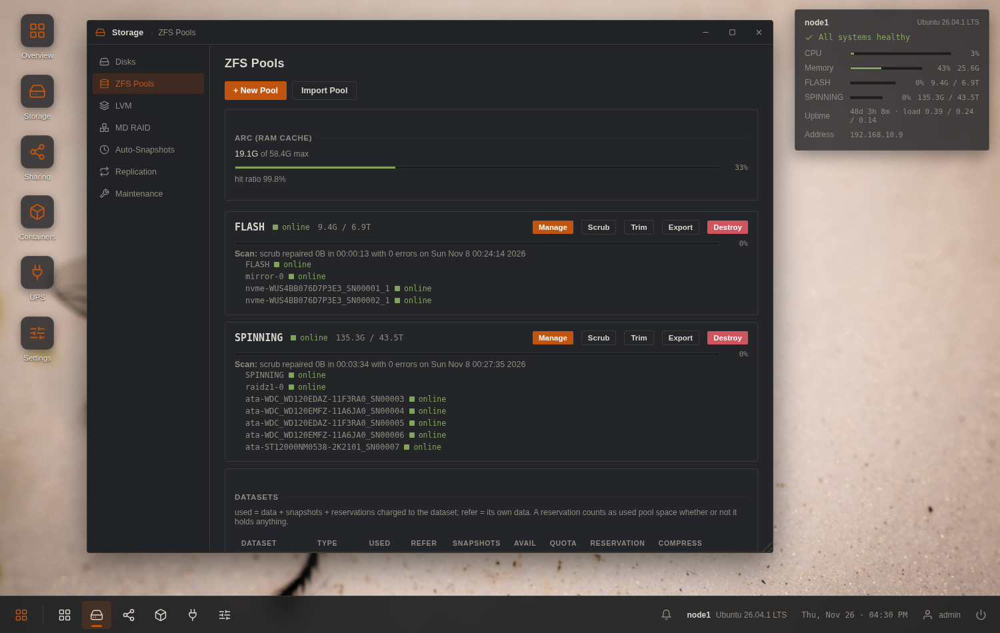<br>**Storage** — ZFS pools, members, scrubs and datasets; LVM, MD RAID, snapshots and replication in the same window. |
| 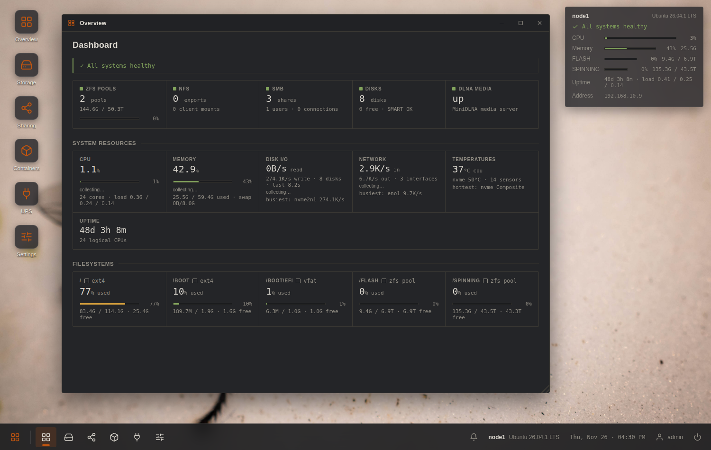<br>**Overview** — health, services, live resources and every filesystem on the node. | 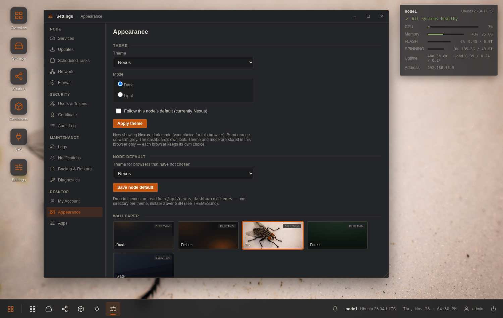<br>**Appearance** — theme, dark/light mode, the node default and the wallpaper. |
| 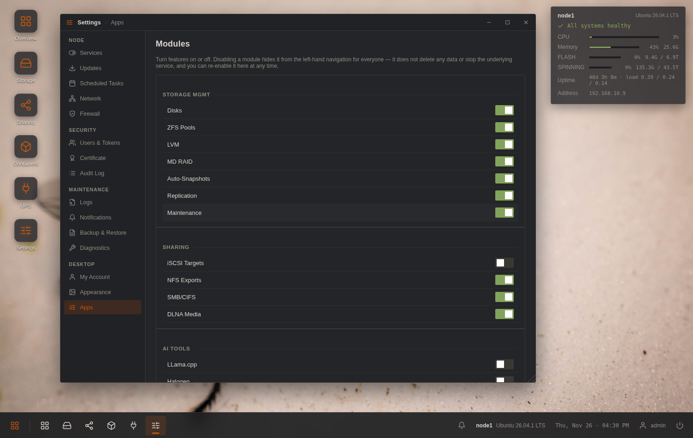<br>**Apps** — per-node module toggles decide which apps a node shows. | 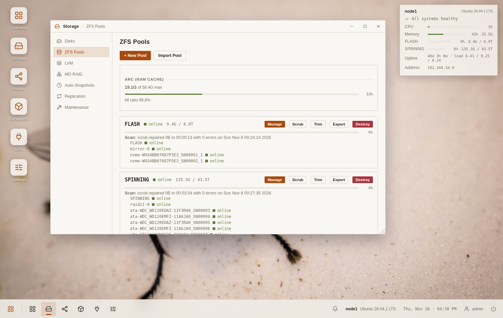<br>**Light mode** — every theme has a dark and a light mode. |

Nexus Dashboard is a single modular web dashboard for a whole home-lab fleet: **storage** (ZFS,
LVM, MD RAID, disks), **sharing** (iSCSI, NFS, SMB, DLNA), **AI tools**
(llama.cpp, Halogen, vLLM Radiance, Affinity, GPU), **containers & VMs** (LXD/Incus), **DNS/DHCP** (dnsmasq),
**UPS/power** (NUT), and **system management** (network/netplan, host firewall
(ufw), services, logs, scheduled tasks, alerting, metrics, history) — one app,
one login, one audit trail per node.

This is the merger of the single-file *Storage/Nexus Dashboard* and the
*Nexus Containers* (LXD) console into one package-structured Flask app.
Per-node **module toggles** decide what each server exposes: a storage node
shows storage+sharing, an AI node shows llama/GPU, an LXD host adds the
Containers pages — same codebase everywhere. Disabled modules are **hard
disabled**: their API routes refuse immediately and disappear entirely at the
next restart.

## Highlights

- **Simple auth** — username/password sessions + API bearer tokens with
  admin/read-only RBAC and per-IP lockout. No client certificates anywhere
  (LXD/Incus is reached over its local Unix socket, which needs only group
  membership).
- **Defensive by construction** — every system command is an argument list
  (`shell=False`) behind pinned sudoers or root-owned wrappers; every
  user-supplied name is allowlist-validated; all config writes are atomic;
  every mutation is audit-logged from one choke point.
- **Fleet-aware** — `/api/version` + `/api/me` capabilities feed the
  NexusController for enroll/skew-detection/auto-classification; Prometheus
  `/metrics`; bounded on-disk history with forecasts.
- **No build step** — vanilla-JS SPA split per category, xterm.js console for
  containers and VM serial + an in-browser **graphical (SPICE/VGA) console** for
  VMs (spice-html5), installable PWA, and nine switchable **themes** in dark
  and light (see below).
- **Inference engines as first-class pages** — one module per way the fleet
  runs a model, each default-off so it costs nothing on a node without it.
  **llama.cpp** (status, presets, logs) with a **Models** page that pulls GGUF
  quants straight from Hugging Face (resume on interrupt, a rate limit in
  Mbps, a write-only HF token for gated repos, split models kept together as
  one directory) and backs the library up to a mounted target with a space
  pre-flight. **Halogen** drives the halogen-server compose stack over the
  Docker socket: start/stop/restart (api alone, without a model reload), boot
  behaviour as the containers' restart policy, the engine's own health,
  throughput, cache and memory-budget lines on the page, alerts for drift
  between the two images and a backing-up queue; both the flash-server and
  the 27B product are understood. **Radiance** manages a vLLM Radiance
  systemd unit: control, enable at boot, and the unit's boot parameters
  (tensor parallelism, context length, batch, speculative decoding, KV
  memory…) edited as a typed allowlist written to a systemd drop-in — never
  the unit file — with a guard against changing the batch shape under a
  pinned KV reservation; telemetry from `/metrics`, `/v1/models` and the
  container's startup log. **Affinity** does the same for an affinity
  DeepSeek unit that exposes no metrics endpoint at all, reading experts
  resident, KV placement and one line per finished request from the
  container log. Every engine reports its loaded checkpoint in the summary
  block, so a fleet console can show what each box is serving.
- **Node backup & restore** — one bundle of every state file that makes a
  node itself (users and tokens, module toggles, SSO, notifications, network
  and replication config, schedules, model presets, the TLS pair, dnsmasq
  state, managed compose stacks), from an explicit allowlist, never a glob.
  Encrypted with a passphrase (HMAC then AES-256-CBC via openssl, no new
  dependency); restore validates every path and checksum and lets you pick
  items. A `config-restore` CLI covers the fresh node that has no admin
  session yet.
- **Diagnostics** — a page that checks what each *enabled* module actually
  needs on this node: root helpers under the node's own prefix, sudoers
  grants, group membership (effective / added but needs a restart / absent),
  timers, service binaries, the Docker socket, state-dir writability,
  certificate expiry. A probe that fails is a warning, never a broken page.
- **Docker beyond the basics** — an image **update checker** compares each
  container's image digest with the registry anonymously (local builds are
  never sent anywhere), with Pull right on the badge, and a **Recreate**
  button applies a pulled image: through `docker compose up` when the stack's
  files are readable, otherwise a settings-preserving clone (networks, static
  IPs, published ports, named *and* anonymous volumes, caps, restart policy)
  that puts the old container back if the new one fails to start.
- **Telemetry the storage card used to hide** — ZFS pools report **usable**
  space, not raw vdev capacity, so a raidz pool stops claiming parity as free
  space; a Filesystems row draws one usage box per real mount or pool; disk
  and network throughput, host and NVMe temperatures, and SMART counters
  tracked **by serial** with a growth alert when a defect counter climbs. On
  the ZFS page zpool's own status and prescribed action appear under the
  badge, per-member error counters show, and `zpool clear` is one click.
- **Patching without leaving the page** — an **Updates** module checks the
  backend package manager (apt on Debian/Ubuntu, dnf on RHEL/Rocky) with
  rootless read-only calls and flags the front page: amber *Updates
  available*, red *Required Security updates available*. The System ▸ Updates
  page lists pending packages (security and reboot-likely tagged), applies
  them all through a root-owned fixed-argv helper with the package manager's
  own output streamed into a live progress bar + log, then reports the
  definitive **reboot-required** verdict — with a Reboot-now button on it.
  Host **reboot / shutdown** live behind the power glyph in the machine strip
  (shutdown wants the hostname typed back), and the strip names the distro
  ("Ubuntu 26.04 LTS") right beside the hostname.
- **UPS monitoring that matches how NUT is actually deployed** — Network UPS
  Tools splits across machines, so it is two modules with two toggles. **UPS
  Server** manages the node the UPS is cabled to (devices and their drivers,
  who may connect, the users clients authenticate as); **UPS Monitor** manages
  every node that UPS feeds — what it watches, when it shuts itself down, and
  which of the sixteen power events log, wall or run a command. A client node
  enables one of them, not both. Battery charge, runtime and load come from
  `upsc` and need no privileges at all, so the dashboard card, the history
  graphs and the on-battery alerts work on a node with no access to a single
  NUT config file. Config edits merge rather than regenerate, so hand-written
  `upssched` wiring and vendor driver parameters survive a save, and passwords
  are write-only: the API reports only that one is set, and leaving the field
  blank keeps the stored value.
- **GPU power tuning, scoped to what the silicon reports** — the GPU page reads
  each card's own limits and offers exactly two controls: a **power cap** and a
  **power profile**, both instantly reversible and safe to change while a model
  is loaded. Clock limits and performance determinism are deliberately left out
  (they can destabilise a running inference job), and controls a card reports as
  unsupported are not drawn at all rather than shown broken. Writes go through a
  root-owned helper that re-validates the value against the card's own reported
  range — the UI's checks are convenience, the helper is the boundary.
- **Firewall without foot-guns** — the Firewall page drives ufw for simple
  inbound allow/deny, but can never block the port serving the dashboard
  itself: it is auto-allowed when enabling or defaulting to deny (without ever
  widening an existing source-restricted rule), deny rules against it are
  refused, and rule deletes are re-verified against the live table first.
- **DNS/DHCP appliance mode** — an optional **dnsmasq** module (default-off)
  turns a node into a DNS/DHCP server: host overrides, CNAMEs, domain
  overrides/forwards, DHCP pools/static leases/options, external network-boot
  options, hosts-file import, and live stats. It owns its config — renders and
  `dnsmasq --test`-validates before every apply (SIGHUP for host/lease edits,
  restart only for structural ones), and a broadcast DHCP probe warns before
  you enable DHCP so you never accidentally run a second DHCP server on the LAN.

## Install

```bash
git clone https://github.com/brainchillz/FlyDash.git
cd FlyDash
sudo ./install-prerequisites.sh        # Debian/Ubuntu packages (single source of truth)
sudo ./install.sh                      # user, venv, sudoers, wrappers, timers, service
# RHEL/Rocky: use install-prerequisites-rhel.sh + install-rhel.sh
```

Serves **HTTPS on 8443** (self-signed by default). First-run admin password is
printed to the service log:

```bash
journalctl -u nexus-dashboard | grep -A2 'initial admin account'
# or set one:
sudo -u dashboard /opt/nexus-dashboard/venv/bin/python /opt/nexus-dashboard/app.py set-password admin
```

**Upgrading an existing install?** After updating the application code, re-run
the installer with `--helpers-only`:

```bash
sudo ./install.sh --helpers-only       # RHEL/Rocky: install-rhel.sh --helpers-only
```

Feature modules rely on root-owned helper scripts in `/usr/local/sbin` and a
sudoers policy that code updates don't touch — this refreshes exactly those
(idempotent; app files, venv, module state and the running service are left
alone). Skipping it after an upgrade can leave a newly added module unable to
apply changes because its helper is missing or outdated.

Fresh installs are named **nexus-dashboard** throughout (`/opt/nexus-dashboard`,
`nexus-dashboard.service` + timers, `/usr/local/sbin/nexus-dashboard-*` helpers).
FlyDash keeps those on-disk names deliberately: a node running Nexus Dashboard
upgrades to FlyDash in place, and fleet tooling, sudoers policy and the
NexusController keep working unchanged.
Nodes upgraded in place from the pre-merge apps keep their original names
(`storage-dashboard` / `llama-dashboard`); the app follows the
`DASHBOARD_UNIT_PREFIX` env var its unit file sets (default `storage-dashboard`).

If a host already runs LXD, Incus or Docker, the installer adds the service
user to the socket group and the Containers/Docker pages light up; otherwise
they simply report the daemon unreachable (or disable the modules on the
Modules page). The Docker pages manage containers, images, volumes and
networks straight over `/var/run/docker.sock` — create (with auto-pull),
lifecycle, logs, live stats, an in-browser shell (bash/sh via exec) — plus
compose stacks: projects already on the host are discovered from their
compose labels and get stack-level up/down/restart/pull/logs, while stacks
created in the UI are stored under the app and validated with
`docker compose config` before they are ever kept.

## Plugins (3.0.0)

Drop a directory into `plugins/` next to `app.py` and restart — it registers
like a built-in module (Modules-page toggle, same auth/RBAC/audit). Two
tiers: a **declarative** one (a single `plugin.yaml` — service card, command
tables, action buttons, log tail; only argv literally written in the file
ever executes) and a **Python** one with full module powers. See
[PLUGINS.md](PLUGINS.md) and the worked examples in `examples/plugins/`
(`hello-world`, `wireguard`).

## Themes (3.11.0)

The look is a theme: a directory with a `theme.json` and a `theme.css` that
redefines the design tokens, plus an optional `theme.js` for effects. Nine
ship with the app — **Nexus** (default), **Phosphor**, **Construct**,
**Pip-Boy** (with its four HUD colours), **Brushed Metal**, **NeXTSTEP**,
**Amber Terminal**, **Solarized Paper** and **Amiga Workbench** — each in
dark and light. Every user
picks one on **My Account → Appearance** (per browser); an admin sets the
node default there. Drop your own into `themes/` next to `app.py` — no
restart, the catalog rescans. See [THEMES.md](THEMES.md).

Six of the themes on the same node, dark and light, in the desktop shell
(screenshots from 4.1.2; click to enlarge):

| Theme | Dark | Light |
|---|---|---|
| **Nexus** | 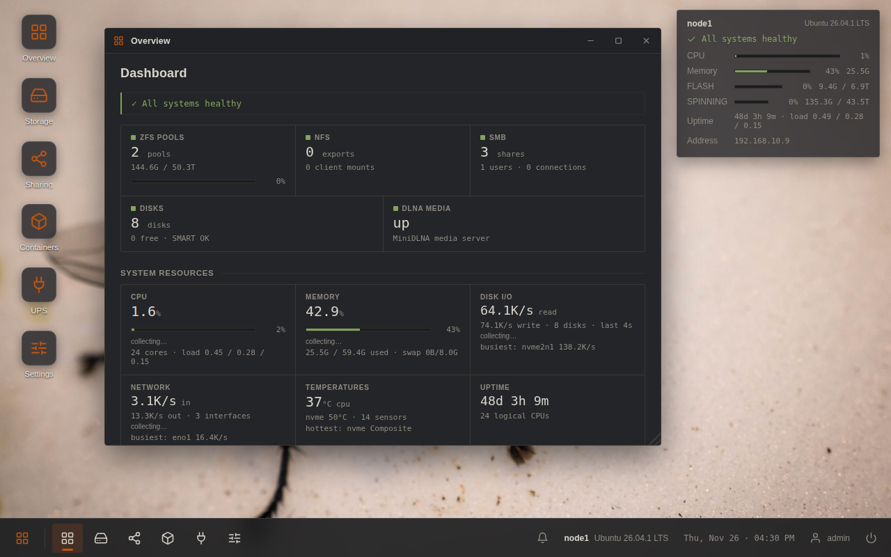 | 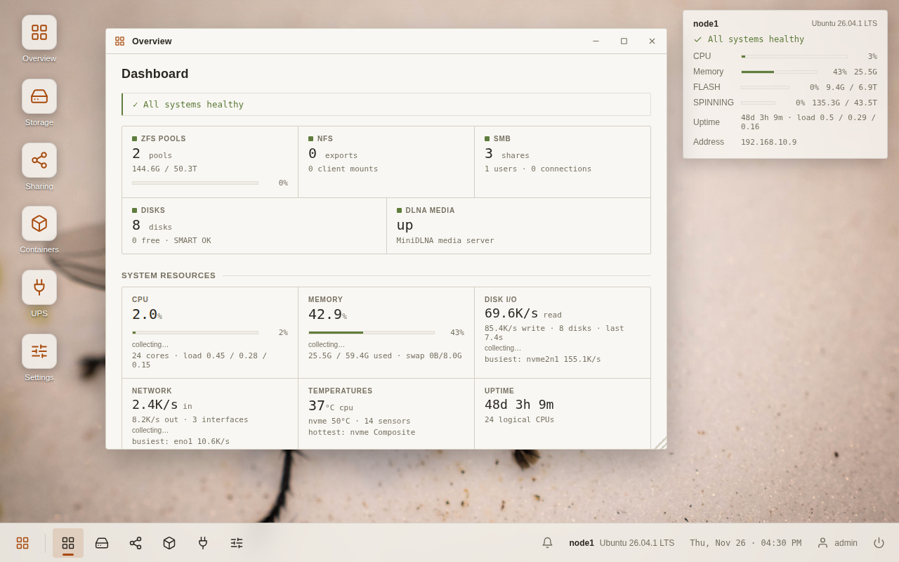 |
| **Phosphor** | 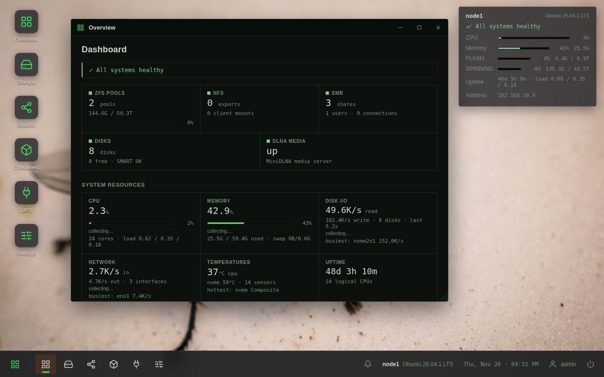 | 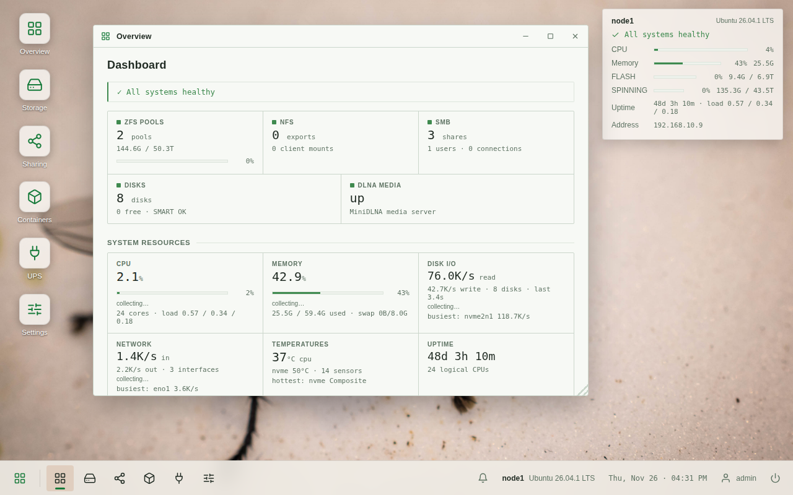 |
| **Construct** | 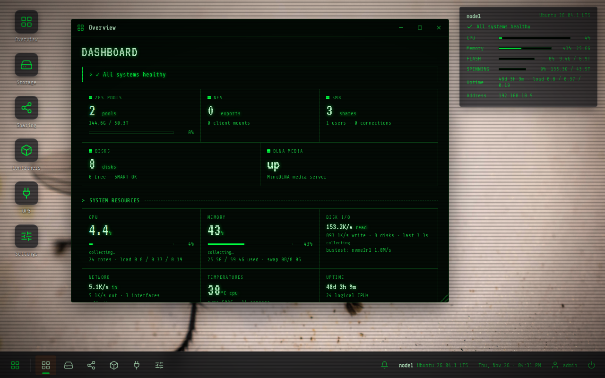 | 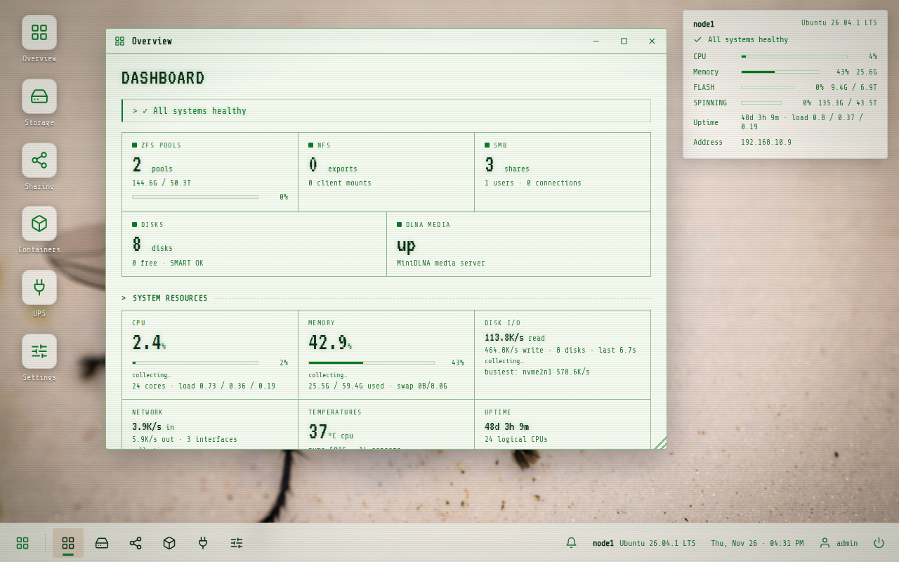 |
| **Pip-Boy** | 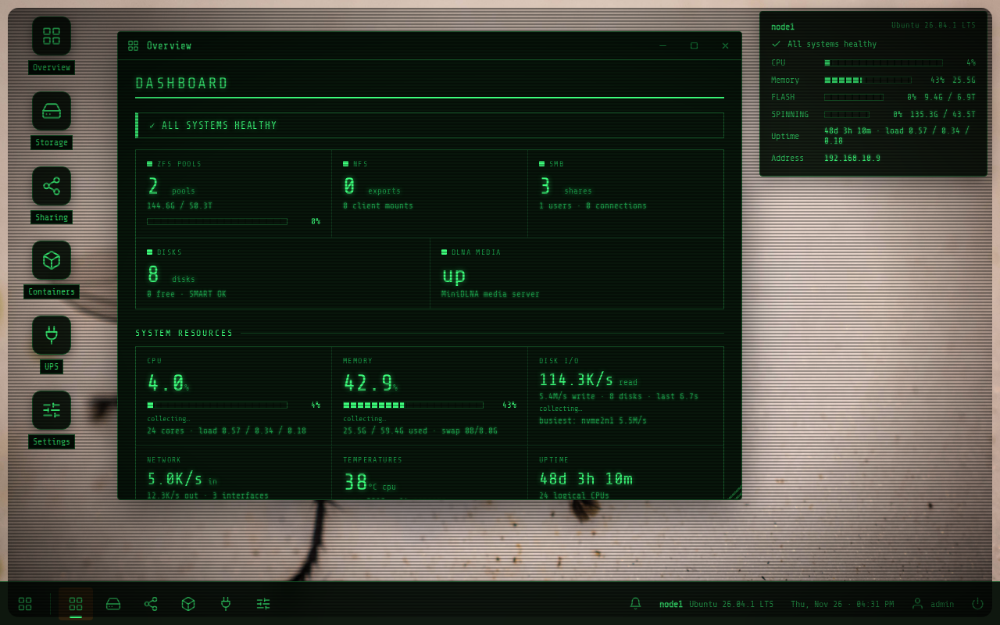 | 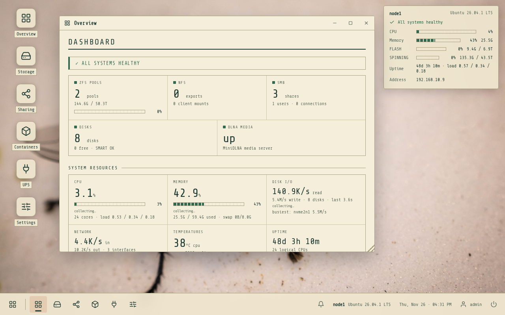 |
| **Amber Terminal** | 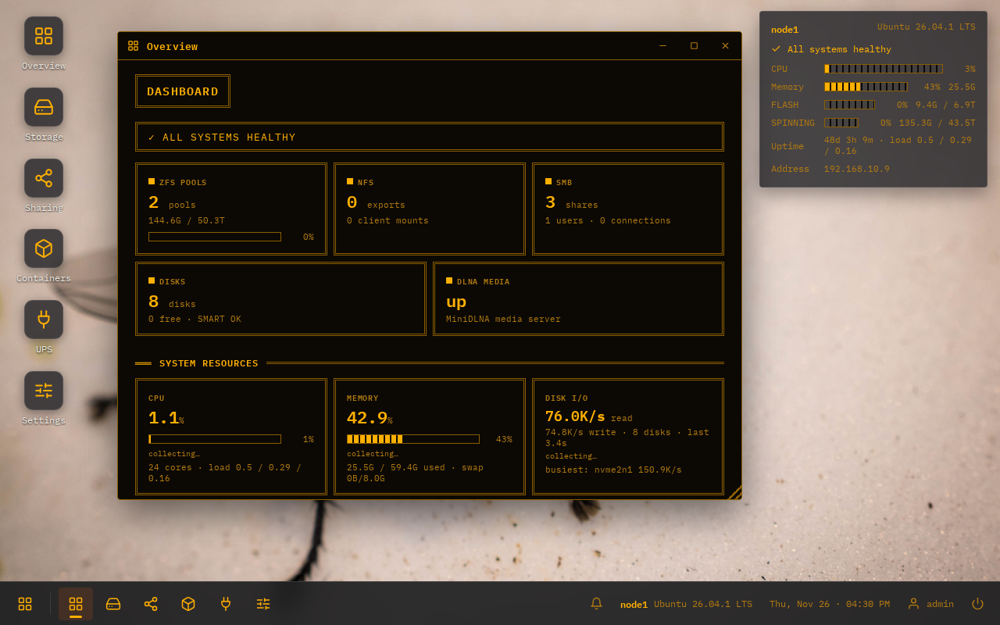 | 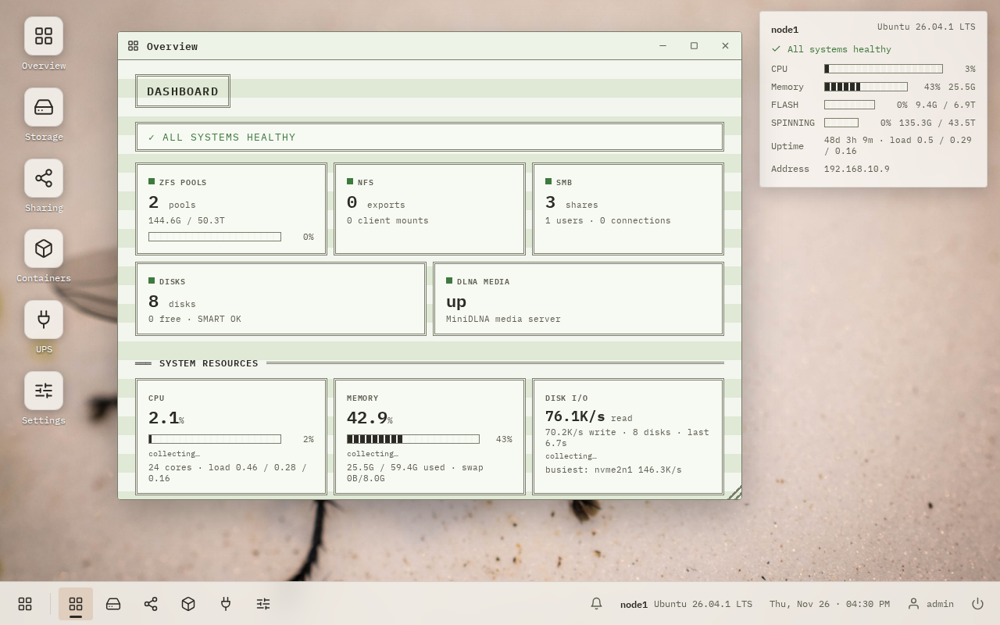 |
| **Solarized Paper** | 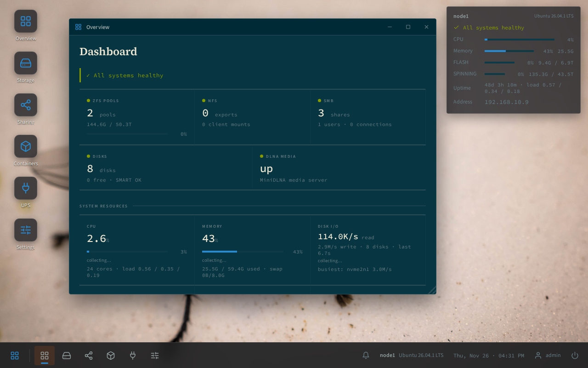 | 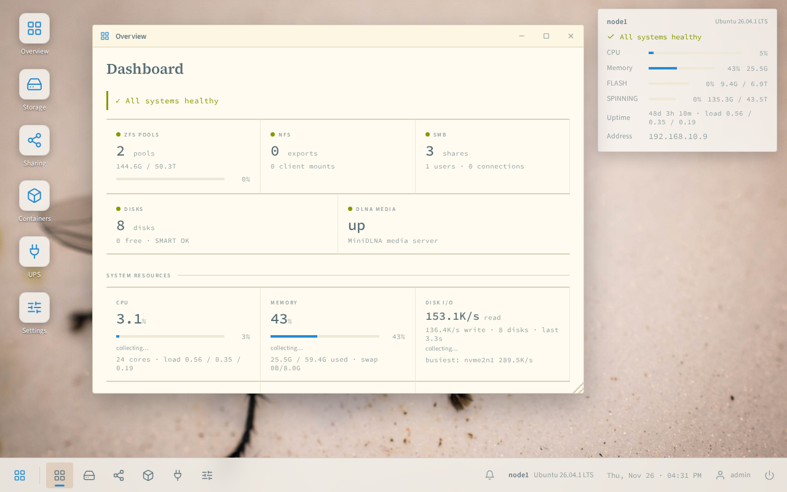 |

A theme restyles the whole desktop — windows, taskbar, launcher, widgets and
every page inside a window — and can carry its own fonts and effects (the
Pip-Boy's scanlines and bezel, Amber Terminal's double-ruled panels).

**Brushed Metal**, **NeXTSTEP** and **Amiga Workbench** also ship. They were
built for the earlier sidebar layout and wrap the page in their own title
bars; in the desktop shell their colours and window styling apply, but that
older chrome still shows on the desktop. They are being reworked for the
shell and are not pictured here until then.

## Single sign-on (optional)

Off unless you configure it, and an unconfigured install behaves exactly as
one built before the feature existed. Point it at a
[Nexus SSO](https://github.com/brainchillz/NexusSSO) issuer and you sign in
once, then reach every enrolled app without another password.

Two ways to opt in, and the **environment wins** so an operator can fix the
decision at install time:

```sh
# host-level, read by the unit via EnvironmentFile=-/etc/nexus-dashboard.env
DASHBOARD_SSO_ISSUER=https://sso.example.com
DASHBOARD_SSO_PUBKEY=<base64url ed25519 public key>
DASHBOARD_SSO_KID=<key id>
DASHBOARD_SSO_AUDIENCE=node1
```

Leave those unset and an admin can enroll from **Users & Tokens → Single
Sign-On** instead, by pasting a one-time code from the issuer; that route
stores the config beside the app's own state, which is what makes it work for
a container without editing `.env` and recreating.

What it deliberately does not do: an assertion names a subject and carries no
role, and the subject must **already have a local account here** — signing in
through an issuer never creates users and never decides what they may do.
Your existing accounts and API tokens are unaffected; this is a browser
feature, and password login keeps working either way. Verification is pure
stdlib (RFC 8032 Ed25519, verify-only), so it adds no dependency.

## Architecture (short version)

```
app.py                  # entrypoint + compatibility facade (import app …)
nexusdash/
  core/                 # auth/RBAC/tokens, audit, TLS, registry, aggregators
  modules/              # disks zfs lvm mdraid schedules replication maintenance
                        # iscsi nfs smb minidlna llama halogen radiance affinity
                        # gpu firewall caddy dnsmasq docker docker_compose
                        # docker_registry updates nut upsmon network logs
  modules/containers/   # LXD/Incus: instances, images, networks, port-forward, console
static/js/*.js          # per-category frontend, no build step
```

Each module registers a descriptor (blueprint + nav entry + optional
summary/alerts/metrics/history/CLI hooks); the registry derives navigation,
capabilities and the hard-disable enforcement from those.

## Tests

```bash
./venv/bin/pip install -r requirements-dev.txt
./venv/bin/python -m pytest tests/ -q     # 1116 tests, no root/hardware needed
```

## Lineage

Replaces (repos now frozen): `brainchillz/NexusStationDashboard` (single-file
dashboard, API kept byte-identical here) and `brainchillz/LXD-Console`.
